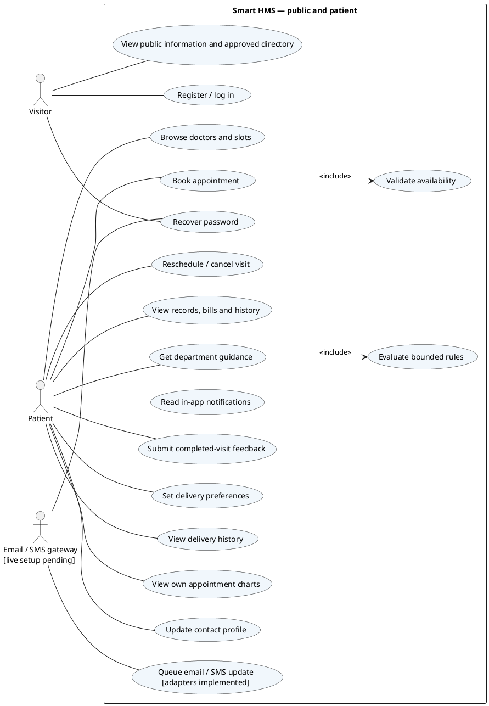
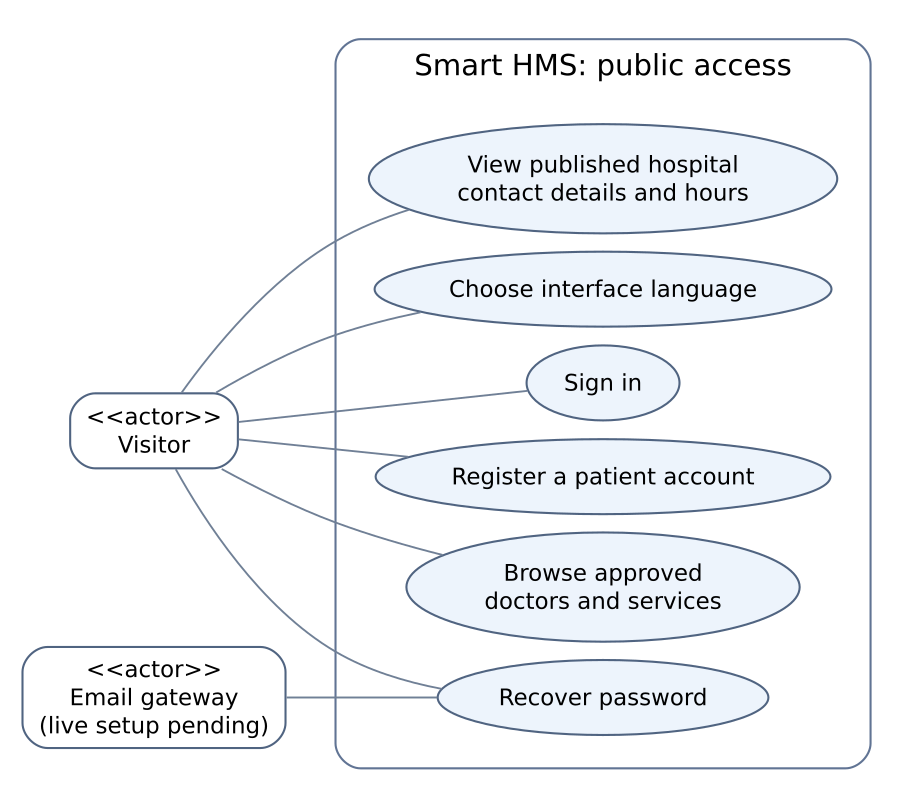
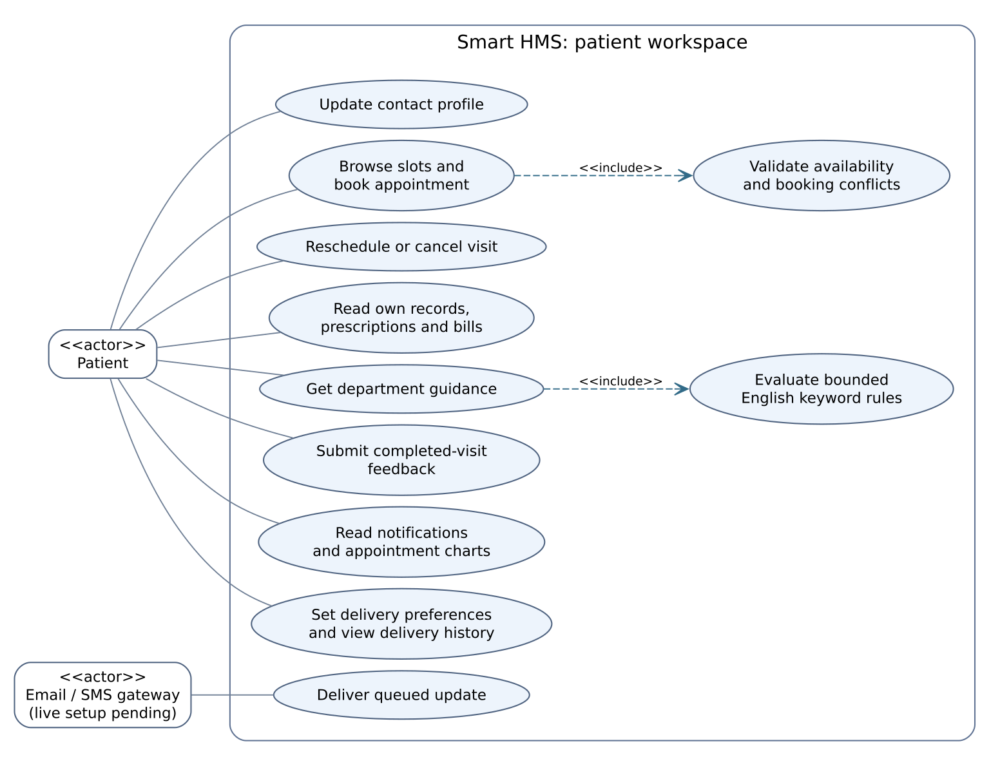
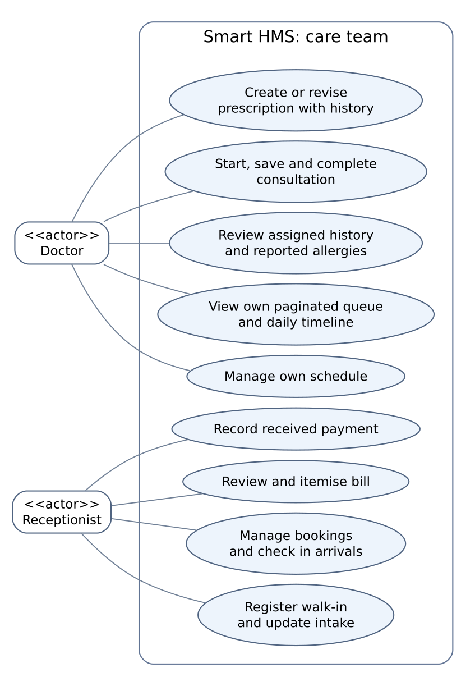
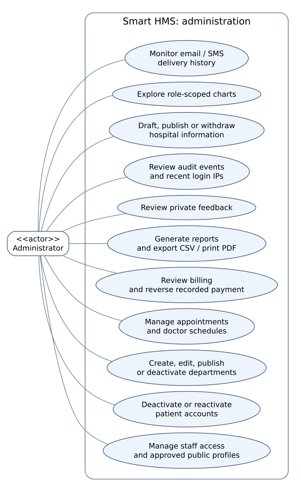

# Revised use case specification

Updated 13 October 2026. The rendered SVG/PNG figures in [diagrams](diagrams) describe implemented application behaviour. The external SMTP/SMS provider is configured only for local/mocked tests; live provider verification remains pending. Diagram source is retained in PlantUML below and editable Graphviz alongside the rendered figures.

| Actor             | Implemented goals                                                                                                                       | Acceptance boundary                                   |
| ----------------- | --------------------------------------------------------------------------------------------------------------------------------------- | ----------------------------------------------------- |
| Visitor           | View published hospital/service/doctor directory, register, sign in, request password recovery, select language                         | Approved publication is explicit; actual SMTP pending |
| Patient           | Maintain contacts; book/reschedule/cancel; view own records/bills; feedback; guidance; notices and delivery preferences/history; charts | Human and language review; guide accepts English only |
| Doctor            | Own live paginated queue, chronological daily timeline, schedules, assigned records, consultations and prescription revisions           | Clinician review                                      |
| Receptionist      | Walk-in registration/intake, bookings, check-in, itemised billing and received-payment recording                                        | Operational acceptance                                |
| Administrator     | Staff/patient access, department lifecycle, approved publication, reports/exports, feedback, audits and delivery monitoring             | Actual hosting/storage/provider access pending        |
| Email/SMS gateway | Adapter processing and provider status handling                                                                                         | Live delivery not verified                            |

Authentication is a precondition on protected use cases. It is not a repeated `include` arrow from every action. Feedback requires a completed owned visit. Prescription revision requires the assigned doctor, existing completed record and reason. Booking includes availability/conflict validation. Symptom guidance includes internal rules; rule evaluation is not an external actor. Successful consultation completion triggers billing and a stored notification within the transaction; external delivery is asynchronous.

The PlantUML source below uses actor associations and `<<include>>` only for mandatory reusable behaviour. External live-service acceptance remains separate from implemented adapters. For the final report, render each view on a separate landscape page or figure; retain the source alongside exported SVG/PDF. The original PDF remains unchanged.

Diagram acceptance: external actors outside the boundary; internal rule engine inside; readable labels at report print size; no relationships that imply every booking uses symptom guidance; no broad administrator access to confidential clinical content merely because the actor is labelled “Admin”.

## Rendered figures

The editable DOT sources generate the following diagrams with `python3 scripts/docs/render-diagrams.py`. The four focused figures split public access from the patient workspace for readability. Actor rectangles use the standard `<<actor>>` classifier notation. Authentication is a precondition; an external gateway association represents an implemented adapter, not verified live delivery.

